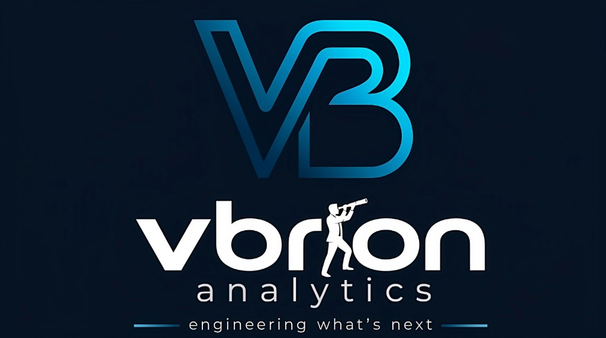
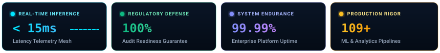

<div align="center">

  <!-- Official Brand Banner -->
  

  <br/><br/>

  <!-- High-Animation Cyberpunk Radar Header -->
  

  <br/><br/>

  <!-- Dynamic Typing Subtitle -->
  <a href="https://vbrion.com">
    
  </a>

  <br/>

  <!-- Live Telemetry KPI Metrics Bar -->
  

  <br/><br/>

  <!-- Quick Action & Verification Badges -->
  <p align="center">
    <a href="mailto:info@vbrion.com"></a>
    <a href="tel:+917718079297"></a>
    <a href="https://www.linkedin.com/company/vbrionanalytics"></a>
    <a href="#"></a>
    <a href="#"></a>
  </p>

</div>


## 🔭 The Stargazer & Telescope • Anatomy of vbrion's Identity

> **"Pioneering foresight. Architecting endurance."**  
> At **vbrion**, we believe the greatest risk facing modern enterprises is not lack of ambition, but reactive blindness. We engineer clarity through the synthesis of strategic consulting and mathematical intelligence.

The **VB** monogram fuses architectural line art with an observer peering through a telescope—symbolizing vigilant foresight, precision measurement, and the unyielding pursuit of truth.

```
                  ┌─────────────────────────────────────────────────────────┐
                  │                 THE VBRION CONVERGENCE                  │
                  ├────────────────────────────┬────────────────────────────┤
                  │     TRADITIONAL HOUSES     │    VBRION ANALYTICS        │
                  ├────────────────────────────┼────────────────────────────┤
                  │ Strategic decks without    │ Strategic consulting fused │
                  │ high-throughput engineering│ with production AI, cloud  │
                  ├────────────────────────────┤ & regulatory telemetry     │
                  │ Standard dev shops without │ Deterministic proof &      │
                  │ boardroom statutory risk   │ board-level governance     │
                  └────────────────────────────┴────────────────────────────┘
```

---

## 🏛️ Foundational Pillars • Principles Governing Our Craft

<table>
  <tr>
    <td width="25%" align="center">
      <h3>🔭 Horizon Foresight</h3>
      <p>Like an astronomer scanning the cosmos, we look beyond quarterly noise to anticipate market shocks, regulatory pivot points, and emergent technological paradigms.</p>
      <sub><i>Engineered with Integrity</i></sub>
    </td>
    <td width="25%" align="center">
      <h3>📐 Mathematical Rigor</h3>
      <p>We replace conjecture with deterministic models, empirical telemetry, and verifiable algorithmic proofs that withstand rigorous regulatory audits.</p>
      <sub><i>Sub-15ms Latency Mesh</i></sub>
    </td>
    <td width="25%" align="center">
      <h3>🛡️ Trust &amp; Governance</h3>
      <p>Engineering resilient compliance architectures, board-level ethical governance, and transparent AI models that preserve enterprise reputation.</p>
      <sub><i>100% Audit Readiness</i></sub>
    </td>
    <td width="25%" align="center">
      <h3>⚡ Sovereign Advantage</h3>
      <p>We do not build generic cookie-cutter dashboards; we forge durable, defensible competitive moats tailored specifically to your business mechanics.</p>
      <sub><i>Sovereign Client Impact</i></sub>
    </td>
  </tr>
</table>


## 🌐 Two Dedicated Divisions • 11 Specialized Practices

From boardroom governance mandates to sub-second streaming inference models, our dual-division model delivers full-spectrum strategic clarity and technological execution.

```
                             vbrion analytics
                                    │
           ┌────────────────────────┴────────────────────────┐
           ▼                                                 ▼
  [STRATEGIC ADVISORY]                              [ANALYTICAL SOLUTIONS]
   Consulting Division                               Engineering Division
   ├─ 🛡️ Risk & Governance                          ├─ 💳 Fintech Solutions
   ├─ ⚖️ Legal Compliances                           ├─ 🏥 Healthcare Analytics
   ├─ 📈 Business Solutions                         ├─ 🏦 Banking Solutions
   ├─ 🎯 Career Consulting                          ├─ 🎓 Education Analytics
   ├─ 🤝 Placement Consulting                       └─ 🚀 Business Development Analytics
   └─ 💻 Technology & Product Engineering
```

### 1️⃣ Strategic Advisory & Consulting Services (6 Service Lines)

<details open>
<summary><b>Expand Strategic Advisory Practices &amp; Key Deliverables</b></summary>
<br/>

| Domain | Practice Focus | Key Deliverables & Systems Engineered |
| :--- | :--- | :--- |
| **STRATEGY** | **🛡️ Risk & Governance** | • Enterprise Risk Management (ERM) Frameworks<br/>• Internal Controls & Audit Readiness Architecture<br/>• Board Advisory & Governance Metric Cockpits |
| **STRATEGY** | **⚖️ Legal Compliances** | • Statutory & Cross-Border Regulatory Mapping Systems<br/>• Multi-Jurisdiction Compliance Audit Shields<br/>• Automated Policy Enforcement & Legal Tracking |
| **STRATEGY** | **📈 Business Solutions** | • End-to-End Operational Bottleneck Diagnostics<br/>• Supply Chain & Resource Allocation Optimization<br/>• Revenue Operations (RevOps) Scalable Architecture |
| **STRATEGY** | **🎯 Career Consulting** | • C-Suite & Senior Leadership Career Roadmaps<br/>• Domain Competency Gap Telemetry Analysis<br/>• Strategic Executive Personal Branding |
| **STRATEGY** | **🤝 Placement Consulting** | • Precision Executive & Quant Talent Headhunting<br/>• Bespoke Candidate Competency Evaluation Suites<br/>• Enterprise Talent Pipeline Architecture |
| **STRATEGY** | **💻 Technology & Product Engineering** | • Digital Product Development & Multi-Tenant SaaS<br/>• Cloud-Native Microservices & Distributed APIs<br/>• Autonomous AI Agent & Copilot Integrations<br/>• Infrastructure Modernization & Automated CI/CD Pipelines |

</details>

### 2️⃣ Data & AI Engineering • Analytical Solutions (5 Service Lines)

<details open>
<summary><b>Expand Analytical Solutions &amp; AI Engineering Practices</b></summary>
<br/>

| Domain | Practice Focus | Key Deliverables & Systems Engineered |
| :--- | :--- | :--- |
| **ENGINEERING** | **💳 Fintech Solutions** | • Real-Time Fraud & Anomaly Detection Engines<br/>• Alternative Data Credit Scoring Models<br/>• Automated Payment Ledger Reconciliation |
| **ENGINEERING** | **🏥 Healthcare Analytics** | • Patient Readmission & Clinical Triage Predictive Models<br/>• HIPAA/GDPR Compliant Health Lakehouse Architecture<br/>• Clinical Resource & Bed Occupancy Optimization |
| **ENGINEERING** | **🏦 Banking Solutions** | • Basel III/IV & Liquidity Stress Testing Tools<br/>• Customer Attrition & Deep LTV Propensity Models<br/>• Automated Anti-Money Laundering (AML) Triaging |
| **ENGINEERING** | **🎓 Education Analytics** | • Student Drop-Out Early Warning Systems<br/>• Curriculum Efficacy & Real-Time Engagement Telemetry<br/>• Institutional Resource Allocation Forecasts |
| **ENGINEERING** | **🚀 Business Development Analytics** | • B2B Account Intent & Propensity Scoring<br/>• Dynamic Pricing & Market Elasticity Simulators<br/>• Territory Potential & Quota Optimization |

</details>


## 🏆 Proven Engineering • 26 Verified Systems & Realized Outcomes

Explore verified enterprise architecture blueprints and quantitative outcomes delivered across mission-critical, regulated industries.

<details open>
<summary><b>🌟 Flagship Production Systems (Featured Case Studies)</b></summary>
<br/>

<table>
  <tr>
    <td width="50%">
      <h4>🏛️ DOTE Admissions Portal 2.0</h4>
      <b>Government Infrastructure · Tamil Nadu (118+ Colleges)</b><br/>
      <i>Key Outcome:</i> Digitized statewide polytechnic admissions across 118+ institutions, processing <b>35,330+ registered students</b> and <b>27,393+ submitted applications</b> with 100% audit compliance.<br/>
      <code>React 18</code> <code>Vite 5</code> <code>Tailwind CSS 4</code> <code>Node.js 20</code> <code>MySQL</code>
    </td>
    <td width="50%">
      <h4>🏥 Lifeline HMS — Hospital Management System</h4>
      <b>Healthcare &amp; Life Sciences · 9 Role Families</b><br/>
      <i>Key Outcome:</i> Unified 9 distinct healthcare role families over a 50+ table MySQL data model, integrating an <b>Orthanc DICOM radiology viewer</b> and <b>sub-200ms bedside telemetry</b>.<br/>
      <code>React 19</code> <code>Vite 7</code> <code>Node.js Cluster</code> <code>Express 5</code> <code>DICOM</code>
    </td>
  </tr>
  <tr>
    <td width="50%">
      <h4>🔒 NEC EMS — Secure Exam &amp; Proctoring Platform</h4>
      <b>Enterprise Assessment · Nandha College</b><br/>
      <i>Key Outcome:</i> Eliminated remote assessment malpractice via zero-trust server-side evaluation, WebSocket telemetry streams, and an automated <b>0–100 student Risk Intelligence Engine</b>.<br/>
      <code>Node.js</code> <code>React</code> <code>MongoDB</code> <code>Redis</code> <code>WebSockets</code>
    </td>
    <td width="50%">
      <h4>🏨 Hotel Management &amp; Reservation Booking System</h4>
      <b>Hospitality Operations · 6-Role RBAC</b><br/>
      <i>Key Outcome:</i> Full-stack booking and internal operations platform engineered with atomic MongoDB transactions, idempotent Razorpay webhooks, and verified <b>k6 load endurance</b>.<br/>
      <code>React 18</code> <code>TypeScript</code> <code>Express</code> <code>MongoDB</code> <code>Razorpay</code>
    </td>
  </tr>
</table>

</details>

<details>
<summary><b>🎓 Campus &amp; Institutional ERP Solutions (10 Systems)</b></summary>
<br/>

| System | Sector / Category | Architectural Innovation & Key Outcome | Stack |
| :--- | :--- | :--- | :--- |
| **NeuroCampus AI** | AI-Native Campus ERP | Unified 8 institutional modules (academics, admissions, attendance, fees, exams, hostel) with CSV permission RBAC and structured Winston logging. | `React 18.3` `Express 4` `MongoDB 7` `JWT` |
| **AccredHub** | NIRF Accreditation Cockpit | Centralized institutional NIRF compliance data collection across faculty, research, and infrastructure with real-time KPI progress tracking. | `React 18` `Express` `Radix UI` `Zod` |
| **AcademiGradePro** | AICTE 360° Faculty Evaluation | Standardized AICTE multi-source faculty evaluations (Student, Peer, HOD, Self) across 6 weighted categories with 28-table normalized MySQL schema. | `React 18` `TypeScript` `Express` `MySQL 8` |
| **OmniLearn ERP** | EdTech & University LMS | All-in-one educational resource planning and LMS platform backed by Supabase PostgreSQL with database-enforced Row Level Security (RLS). | `React 18` `Vite` `TypeScript` `Supabase` |
| **CampusCore** | Academic Management | Centralized curriculum planning, Course Outcome (CO-PO) mapping, and multi-mode attendance (Manual/QR/Biometric) with real-time notifications. | `React 18` `Vite` `TypeScript` `Supabase` |
| **Fusion LMS** | Higher Education ERP & Exam | Unified ERP + LMS spanning admissions, timetabling, virtual classrooms, question bank authoring, hall tickets, and revaluations. | `React 18` `Node.js` `Express` `TypeScript` |
| **Exaura** | Assessment Suite SPA | Assessment-lifecycle SPA featuring institutional onboarding, faculty masters, and timetable scheduling powered by an in-browser mock-API interceptor. | `React 18` `Tailwind 3` `Router 6` `Framer Motion` |
| **AssessMatrix** | Collision Detection Engine | Advanced timetable scheduling engine with automated room and faculty collision detection, bulk data sync, and student result analytics. | `React 18` `Node.js` `Express` `MySQL2` |
| **SF-ERP / CMS** | SaaS ERP (100k+ Target) | Algorithmic exam-seat allocation (Horizontal, Vertical, Zigzag, Wave) with Kubernetes pod autoscaling and master control plane. | `React 18` `Node.js` `Express 5` `MySQL 8` `K8s` |
| **LEO** | Desktop App · 620 Students | Automated LeetCode problem fetching and daily contest gap analysis for 620 students, tracking 65,834+ solved problems with offline SQLite storage. | `Electron` `Electron-Builder` `React` `Vite` `SQLite` |

</details>

<details>
<summary><b>💳 Fintech, Real-Time Messaging &amp; Industrial Systems (4 Systems)</b></summary>
<br/>

| System | Sector / Category | Architectural Innovation & Key Outcome | Stack |
| :--- | :--- | :--- | :--- |
| **IrisPay** | Biometric Aadhaar Gateway | Biometric Mantra MFS110/MIS100 hardware simulation with Aadhaar ecosystem, enabling cardless, PIN-less digital transactions for semi-urban inclusion. | `React 18` `TypeScript` `Vite` `Shadcn UI` |
| **MattressPro Forecast** | Manufacturing Analytics | Output forecasting engine correlating real-time worker attendance and material constraints, with dedicated shop-floor TV Mode. | `React 18` `Vite` `Express 5` `Shadcn UI` |
| **WhatsApp Web Clone** | MERN + WebSockets | Sub-50ms message delivery via Socket.IO, typing indicators, read receipts, and multi-container Docker deployment. | `React` `Vite` `Node.js` `Express` `Socket.IO` |
| **ChatEcho-44** | Low-Latency Messaging | High-concurrency messaging application using Supabase Realtime and PostgreSQL Change Data Capture (CDC) with optimistic client UI rendering. | `React 18` `TypeScript` `Vite` `Supabase CDC` |

</details>

<details>
<summary><b>👥 Enterprise HR, Payroll &amp; Foundation Architectures (6 Systems)</b></summary>
<br/>

| System | Sector / Category | Architectural Innovation & Key Outcome | Stack |
| :--- | :--- | :--- | :--- |
| **Enterprise HRMS** | Employee Management | Full-stack MERN HR solution with debounced paginated employee registries and database-level MongoDB aggregation analytics. | `React 18` `Tailwind CSS` `Node.js` `Express` |
| **EPEMS HRMS** | Statutory Payroll & Attendance | Statutory payroll (PF/ESI/PT) with GPS and selfie-verified biometric attendance, secured by cryptographically chained audit logs. | `React 18` `Node.js` `Express` `MySQL 8` |
| **OptiCode Prime** | React Starter Foundation | 40+ pre-optimized Shadcn components, strict TypeScript typing, and TanStack Query state hydration eliminating boilerplate. | `React 18` `Vite` `TypeScript` `Tailwind CSS` |
| **NexusUI** | Feature-Modular Core | Modular frontend design system allowing new business domains to drop into production without modifying existing foundational logic. | `React 18` `TypeScript` `Vite` `Bun` |
| **Weather Platform** | Serverless Geocoding | Serverless weather intelligence via Cloudflare Pages Functions utilizing Open-Meteo APIs with zero API keys required. | `React 18` `Vite 8` `Tailwind 3` `Cloudflare Functions` |
| **Tableau BI Suite** | Big Data & Executive BI | Multi-year enterprise sales dataset modeling with Level of Detail (LOD) calculations, VizQL queries, and Hyper Data Extracts. | `Tableau Desktop` `VizQL` `Hyper Extracts` |
| **EventSphere** | Digital Events Platform | Premium dark-themed static landing platform centralizing community event discovery with deep external commerce integrations. | `HTML5` `CSS3 Modern` `JavaScript` `SEO` |

</details>


## ⚡ Tier-1 Capabilities & Technology Ecosystem

We don't experiment with unproven toys on your infrastructure. Our engineers harness battle-tested tools across data engineering, neural architectures, and distributed systems.

<br/>

| Discipline | Focus Area | Production Technologies & Tooling |
| :--- | :--- | :--- |
| **Data Lakehouses &amp; Telemetry** | High-throughput pipelines &amp; semantic data models |        |
| **AI / ML &amp; Predictive Intelligence** | Custom neural nets, forecasting &amp; LLM copilots |        |
| **Dashboards &amp; Executive BI** | Boardroom-ready foresight cockpits &amp; VizQL |       |
| **Digital Product Engineering** | High-performance SaaS &amp; distributed microservices |        |
| **Cloud &amp; DevOps Modernization** | Elastic, zero-trust cloud orchestration |       |
| **Intelligent Process Automation** | Self-healing workflows &amp; document AI |     |


## 📈 Empirical Benchmark Outcomes

```
┌────────────────────────┬────────────────────────┬────────────────────────┬────────────────────────┐
│  PRODUCTION ML PIPES   │   AUDIT PASS RATE      │ RESOURCE OPTIMIZATION  │   REGULATED SECTORS    │
│         109+           │        91.1%           │         34%            │           7+           │
│  Analytics & AI Deployed │  Statutory Compliance  │  Average Efficiency    │  High-Stakes Verticals │
└────────────────────────┴────────────────────────┴────────────────────────┴────────────────────────┘
```

---

## 🔄 Delivery Lifecycle • From Horizon Discovery to Production Endurance

```
  [01: WEEKS 1–2]          [02: WEEKS 3–4]          [03: WEEKS 5–8]          [04: ONGOING]
 Discover & Align   ───►  Design & Prototype ───►  Build & Integrate  ───►  Scale & Governance
 • Friction Mapping        • Architecture Specs     • Hardened Microservices  • Model Drift Telemetry
 • KPI Definition          • Mathematical Proof     • Automated CI/CD         • 24/7 SLA Assurance
 • Architecture Blueprint  • Sanitized Benchmark    • Seamless Ingestion      • Observability Cockpit
```


## 👥 Leadership & Core Engineering Pillars

Meet the visionary founders, technology heads, and engineering specialists powering vbrion's digital transformation and client success.

<table>
  <tr>
    <td width="25%" align="center">
      <br/>
      <b>Amjath Basha</b><br/>
      <sub>Director</sub><br/>
      <p><i>Strategic Direction, Corporate Governance &amp; Enterprise Growth Partnerships</i></p>
    </td>
    <td width="25%" align="center">
      <br/>
      <b>G Chellammal</b><br/>
      <sub>Leadership, Finance &amp; Ops</sub><br/>
      <p><i>Financial Strategy, Operations &amp; Statutory Compliance Oversight</i></p>
    </td>
    <td width="25%" align="center">
      <br/>
      <b>Vaishnavi C</b><br/>
      <sub>Business Head</sub><br/>
      <p><i>Institutional Accounts, Enterprise Alliances &amp; Consultative Engagements</i></p>
    </td>
    <td width="25%" align="center">
      <br/>
      <b>Nesarajan PN</b><br/>
      <sub>Software Development Lead</sub><br/>
      <p><i>Systems Architecture, Engineering Delivery &amp; Full-Stack Tech Leadership</i></p>
    </td>
  </tr>
  <tr>
    <td width="25%" align="center">
      <br/>
      <b>Prawin Kumar N</b><br/>
      <sub>Software Development Engineer</sub><br/>
      <p><i>Full-Stack Platforms, Clean Architecture &amp; Database Optimization</i></p>
    </td>
    <td width="25%" align="center">
      <br/>
      <b>Manoj Hariharan</b><br/>
      <sub>Software Engineer</sub><br/>
      <p><i>Scalable Backend Platforms, Microservices &amp; High-Throughput Services</i></p>
    </td>
    <td width="25%" align="center">
      <br/>
      <b>Kungumanithish K</b><br/>
      <sub>Frontend Developer</sub><br/>
      <p><i>Modern UI/UX Systems, Responsive Web Applications &amp; Micro-Animations</i></p>
    </td>
    <td width="25%" align="center">
      <br/>
      <b>Manoj Anbalagan</b><br/>
      <sub>AI Engineer</sub><br/>
      <p><i>Deep Learning Models, Advanced Neural Workflows &amp; Generative AI Integrations</i></p>
    </td>
  </tr>
</table>


## 🏢 Corporate Network & Global Advisory Desk

Whether evaluating regulatory risk, structuring an algorithmic trading pipeline, or modernizing your healthcare lakehouse, our principals are ready to engage.

<div align="center">

```
  ┌────────────────────────────────────────────────────────────────────────┐
  │                 VBRION ENGAGEMENT GUARANTEE PROTOCOL                   │
  │  🔒 Strict Mutual NDA   │   ⏱️ 24-Hour Response SLA   │   👔 Principal Review │
  └────────────────────────────────────────────────────────────────────────┘
```

<br/>

| Channel | Contact Coordinates | Operational Hours |
| :--- | :--- | :--- |
| **📞 Direct Desk** | `+91 7718079297` | Monday – Saturday, 9:00 AM – 7:00 PM IST |
| **✉️ Official Inquiries** | `info@vbrion.com` | Monitored 24/7 by Senior Partners |
| **💬 WhatsApp Business** | [Initiate Chat (+91 7718079297)](https://wa.me/917718079297) | Direct Advisory Desk |
| **🌐 Corporate LinkedIn** | [vbrion analytics LinkedIn](https://www.linkedin.com/company/vbrionanalytics) | Corporate Research & Announcements |
| **📍 Registered Presence** | **No. 301/180, Vinayagar Kovil Street, 10-A, Nadar Medu, Erode – 638002, Tamil Nadu, India** | Corporate Headquarters |

<br/>

<a href="https://wa.me/917718079297">
  
</a>
&nbsp;&nbsp;
<a href="mailto:info@vbrion.com">
  
</a>
&nbsp;&nbsp;
<a href="tel:+917718079297">
  
</a>

<br/><br/>

<sub>© 2026 vbrion analytics. All rights reserved. • Tagline: <b>“Engineering What's Next”</b> • Looking Beyond The Curve</sub>

</div>
